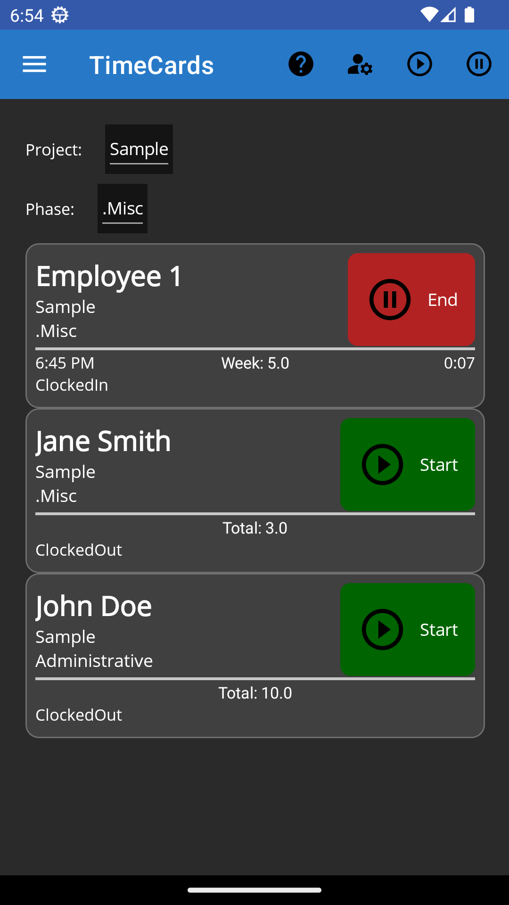
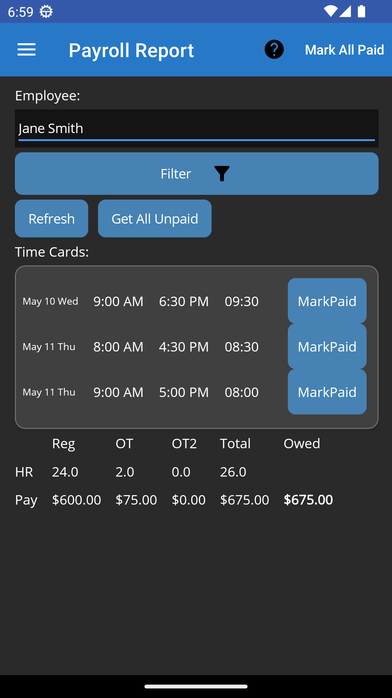
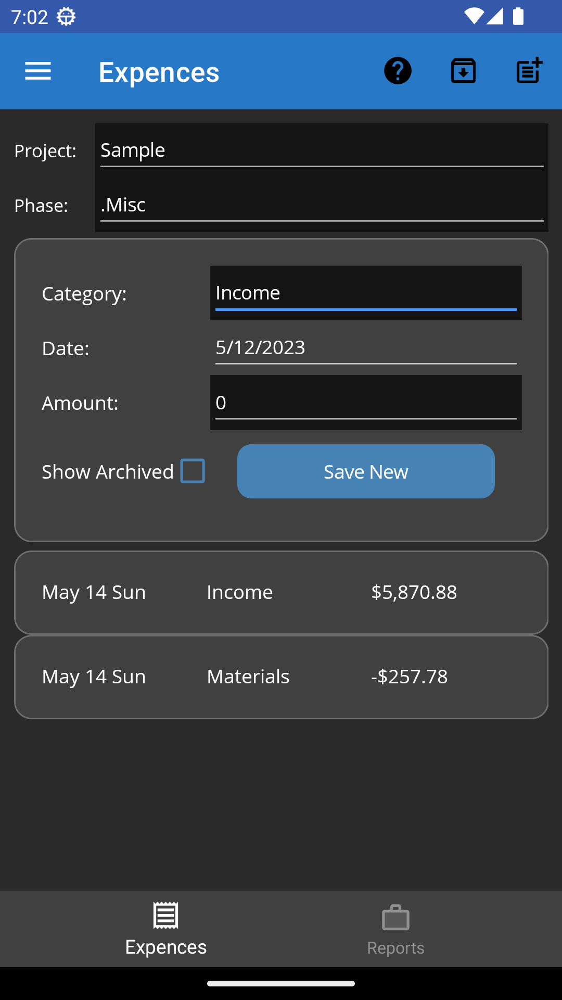
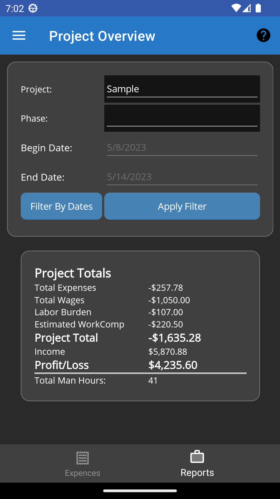

# Time Cards App

## .NET 11.0 MAUI app for Android 10+ using a SQLite database.

Simple app for employer to track employees time cards for payroll use. Supports multiple employees over different projects.


### Features

* Track employee hourly time cards for payroll purposes (Does not calculate any taxes, SSI, FUTA, etc.)
* Uses California labor laws for overtime calculations. (Any work after 40 hours in a single week is overtime. Also, any work over 8 hours in a single day is overtime at time and a half. After the 12th hour in a single day is double overtime)
* Totals employee hours for a given pay period and calculates the gross amount (before taxes) to be paid to the employee
* Ability to mark a time card as paid and the date it was paid. This will flag the time card as ReadOnly and no further changes can be made to it.
* Estimates the approximate workers compensation cost for the employee based on the gross amount paid to employee
* Support for multiple employees and projects
* Track hours worked on tasks for each project
* Track expenses for each project
* Invoice generation
* Reports of total hours worked, project costs and expenses. Filter by project, task, employee, and/or date range
* Ability to notify user by alarm or toast message when a employee is approaching overtime hours or the end of a shift for the day
* Edit a single or multiple time cards at once
* Dark, Light or follow the system theme
* Material 3 design on Android
* Backup the entire database data by export and import functionality (CSV format files in a single ZIP file)
* No internet connection required. All data is stored locally in a SQLite database. 
* or MSSQL server can be used as the database backend. This is not enabled by default and is experimental.
* Supports use of database Migrations
* MAUI app for Android 10+ and Windows 10+ (Not tested on iOS)

### Screenshots

| screenshots | screenshots |
| --- | --- |
|  |  |
|  |  |

---

### Notes

Built using .NET 11.0.100-preview.7.26381.103 and Visual Studio 2026

Requires the .NET workloads 
```
android
maui-android
maui-windows
```
and uses the following nuget packages:
```
"CommunityToolkit.Maui" Version="15.0.1"
"CommunityToolkit.Mvvm" Version="8.4.2"
"Microsoft.Maui.Controls" Version="11.0.0-preview.7.26406.9"
"CsvHelper" Version="33.1.0"
"Microsoft.EntityFrameworkCore.Sqlite" Version="11.0.0-preview.7.26381.103"
"Plugin.LocalNotification" Version="14.1.1"
```
---

### QuickStart
__Build and run the app.__ 
The app will create a SQLite database file in the local app data folder. The database will be created with some default seed data for employees, projects, tasks, and expense types.

---

### How to customize the seed data
It is recommended that you change the default seed data to your own values and deleting the [TimeClockApp.Shared\Migrations](/TimeClockApp.Shared/Migrations) folder before using the app. 
1. Deleting the example [TimeClockApp.Shared\Migrations](/TimeClockApp.Shared/Migrations) folder
2. Edit the file [TimeClockApp.Shared\Models\DataBackendContext.cs](/TimeClockApp.Shared/Models/DataBackendContext.cs) to change the default seed data values.
3. Rebuild the solution and follow the instructions in the [EFMigrator\README.md](/EFMigrator/README.md) to create the new initial migration files and the migration database with your new seed data.
4. Rebuild the solution and run the app. The app will create a SQLite database file in the local app data folder with your new seed data. 
    
    * NOTE: Just uninstalling the app may not remove the database on the device and it might persist between installs.
    To ensure the database is removed, you should 1) __Clear__ the apps storage then 2) __Uninstall__ the app.    
    (On Android: Goto Settings -> Apps -> Time Cards App -> Storage & cache -> Clear storage ) 

### How to change the SQLite database file name or location (Not recomended)
SQLite (Default database) To change the name or location of the SQLite database file for creation,
see the property 'sQLiteDbFileName' in file [TimeClockApp.Shared\SQLiteSetting.cs](/TimeClockApp.Shared/SQLiteSetting.cs)

### MSSQL Server connection string
(Experimental) The use of MSSQL Server for the database is not recommended. It requires a network connection to the database and adds additional latency to the app, making the app feel slow. Use this at your own risk.

For MSSQL the connection string is hard coded in to the app. To change the connection string,
see the property 'mSQLconnStr' in file [TimeClockApp.Shared\MSSQLSetting.cs](/TimeClockApp.Shared/MSSQLSetting.cs)

---

### Migrations- How to use EFMigrator
See [EFMigrator\README.md](/EFMigrator/README.md)

---

### Release Notes

3.1
* Added support for .NET 11.0.0-preview.7.26406.9 and latest nuget packages.
* Added EditMultipleTimeCardsPage to edit multiple time cards at once.
* Settings are now stored Preferences and synced with database values
* Removed notification and old settings pages; all settings unified on more UI friendly page
* Improved export/import UX with progress bar
* Added Autocorrecting of ClockIn times when it is greater than ClockIn and past 12pm. Autocorrects ClockIn to AM time.
* Optimized XAML by removing unnecessary layouts, controls, styles, and bindings to improving performance and reducing memory usage
* Removed unused styles and moved some styles to appropriate pages
* Refactored ViewModels to use toast notifications
* Removed blocking calls and optimized queries to improved app responsiveness
* General code cleanup, removed unused files, improved nullability

2.3
* Faster First Paint**: UI appears to user 20-30% faster by eliminating 6+ seconds of blocking delays
* **Reduced First Launch Time**: Deferred non-critical initialization reduces initial startup
* **Smoother User Experience**: No ANR (Application Not Responding) dialogs during initialization
* Deferred Database Initialization. Created `IStartupService` interface for managing asynchronous startup tasks. Implemented `StartupServiceImpl` to handle database migrations on a background thread
* Async Database Initialization. Updated `DataBackendContext` with `InitializeDatabaseAsync()` method. Migrations run on thread pool thread to avoid UI blocking

2.2
* Added support for .NET 11.0.0-preview.5.26304.4 and latest nuget packages.
* Added Material 3 design on Android
* Preliminary support for LocalNotification on Android 13+ devices. (Requires user to allow notifications for the app)
* Use CoreCLR on Android

2.1
* Minor bug fixes
* Many code cleanup and optimizations
* Added experimental support to use MSSQL server as the database backend.
* Fixed issue of not working on windows platform.
* Updated to .NET 10.0.1 and latest nuget packages.
* Improved exception logging for async methods.
* Improved UI responsiveness when loading large data sets.
* Improved overall app stability.

2.0
* Add invoice and Invoice detail pages
* bug fixes
* Removed unused code
* Fixed NumericValidationBehavior and TextValidationBehavior not working
* Better exception error logging with for async methods

1.8 
* Moved ExpenseType from a Enum into a database table. 
* Added EditExpenseTypePage. 
* Auto add Expense entry for the amount paid out for payroll along with a entry for WorkersComp amount.
* Reorder the Shell Flyout menu. 
* Add version check during data Import, Prior exported data will not be allowed to be imported in. (It is possible but the Expense.csv and Config.csv files would need edit to make compatible)

1.7 
* minor bug fixes. Code cleanup.
* Fixed issue when deploying in Release mode to physical device, app would crash upon startup.

1.6 
* Add ReportPage to view the total cost for a project, date range, per employee, etc. 
* Fixed issue with PayrollDetail grouping.  
* Moved FileService and SQLiteSetting class to TimeClockApp.Shared 
* Removed the project TimeClockApp.FileHelper

1.4
* Fix issue with multiple timecards on the same day, that would not correctly add up the hours for overtime.
* Fix issue with double overtime (As per overtime in USA any work over 8 hours in a single day is overtime. After the 12th hour it is double overtime)
* Redesigned the payroll detail page.
* Fixed issue with the backup of the entire sqlite database file. Can only make a copy of current database. Still can not import that file. Only import via CVS files is supported
* Removed unnecessary Wages table from database
* Fixed issue of a timecard from a prior date that was not clocked out of.
* Now uses EF migrations to create and update the database.  See migrations section below
* Database has been changed between v1 to v1.4. If you have any data you want to keep, before upgrading to version 1.4, backup your current data by using `Tools`->`Backup`->`Export Data` This will create a ZIP file containing all the SQLite table data in CSV files.
Then after upgrading, use `Tools`->`Backup`->`Import Data` to restore your data.

1.0
* Initial Release

